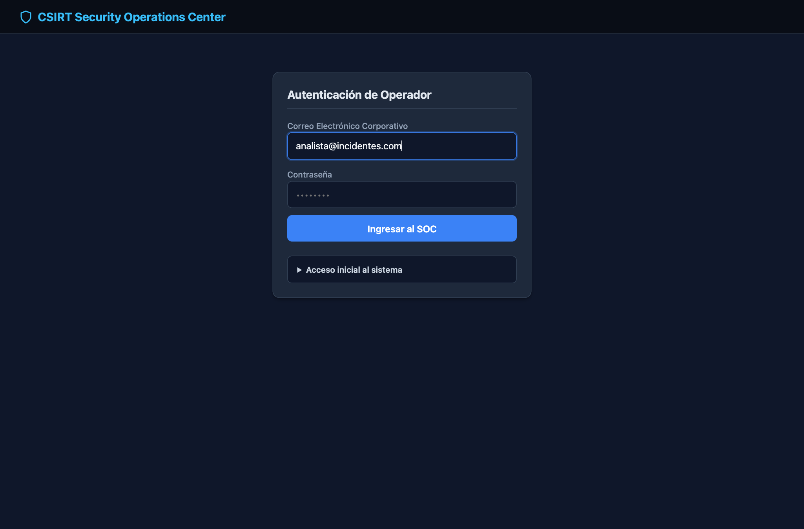
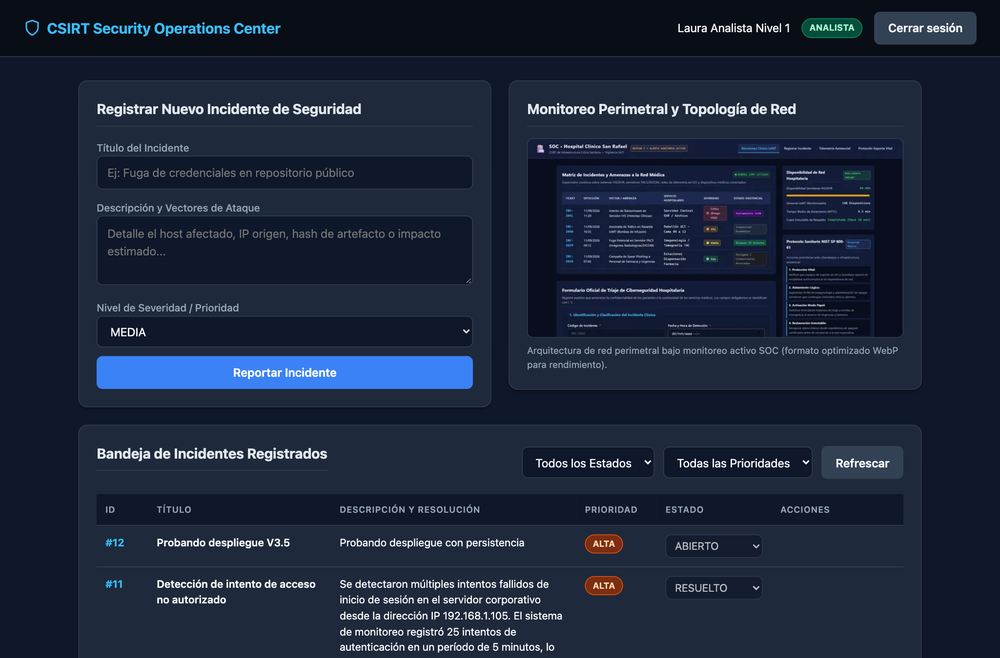
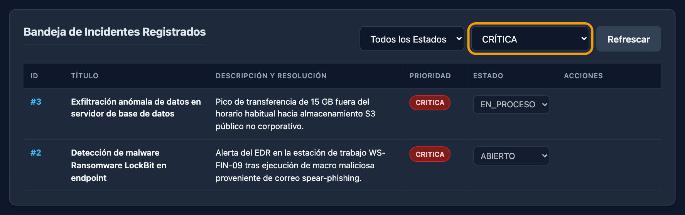
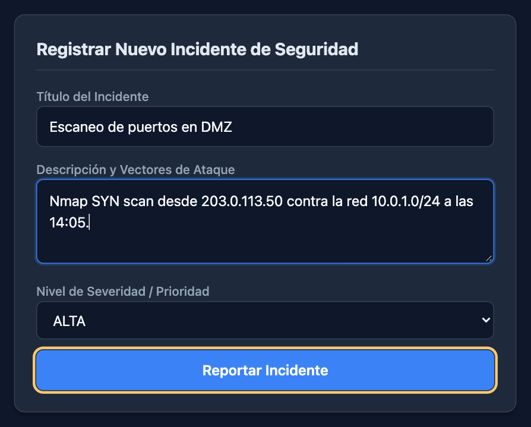
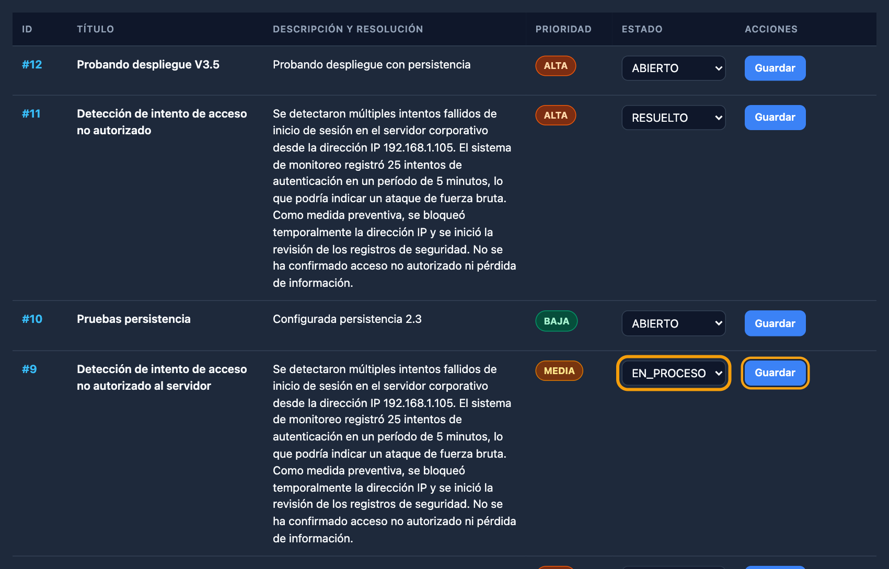
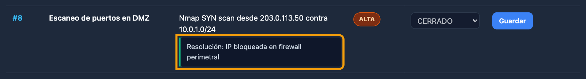
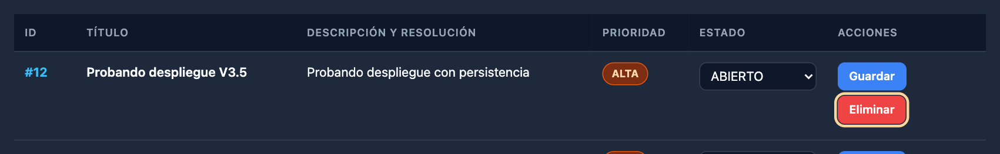

# Manual de usuario · Plataforma de gestión de incidentes CSIRT/SOC

La Plataforma de gestión de incidentes es una aplicación web para registrar, consultar y dar seguimiento a los
incidentes de ciberseguridad que atiende el equipo CSIRT/SOC. Está pensada para analistas, supervisores y
administradores del equipo. No necesitas conocimientos técnicos para usarla: este manual explica cada tarea
paso a paso.

> [!NOTE]
> Si necesitas información sobre instalación, despliegue o la API, consulta el
> [Manual técnico](MANUAL_TECNICO.md) o el [README del expediente](README.md).

## Tabla de contenidos

- [1. Acceso a la plataforma](#1-acceso-a-la-plataforma)
- [2. Iniciar sesión](#2-iniciar-sesión)
- [3. Los tres perfiles](#3-los-tres-perfiles)
- [4. Recorrido de la interfaz](#4-recorrido-de-la-interfaz)
- [5. Consultar y filtrar incidentes](#5-consultar-y-filtrar-incidentes)
- [6. Registrar un incidente](#6-registrar-un-incidente)
- [7. Actualizar el estado](#7-actualizar-el-estado)
- [8. Cerrar un incidente](#8-cerrar-un-incidente)
- [9. Eliminar un incidente](#9-eliminar-un-incidente)
- [10. Preguntas frecuentes y solución de problemas](#10-preguntas-frecuentes-y-solución-de-problemas)
- [11. Buenas prácticas de uso](#11-buenas-prácticas-de-uso)
- [12. Glosario](#12-glosario)

## 1. Acceso a la plataforma

Abre tu navegador y entra en esta dirección:

**https://csirt-incidentes-javier.onrender.com**

La plataforma funciona en las versiones actuales de Google Chrome, Microsoft Edge, Mozilla Firefox, Safari y
Brave. También se adapta a pantallas de tableta y de teléfono móvil.

Comprueba que la barra de direcciones muestre el candado y que la dirección empiece por `https://`. Esto indica
que la conexión está cifrada.

> [!NOTE]
> **La primera carga puede tardar alrededor de un minuto.** El servicio se aloja en un plan gratuito que se
> pone en pausa cuando nadie lo usa durante unos 15 minutos. La primera visita lo despierta. Espera sin cerrar
> la página: las siguientes cargas son inmediatas.

## 2. Iniciar sesión

1. En el campo **Correo Electrónico Corporativo**, escribe el correo que te asignó el administrador.
2. En el campo **Contraseña**, escribe tu contraseña. Debe tener al menos 8 caracteres.
3. Pulsa **Ingresar al SOC**.
4. Si los datos son correctos, verás el panel principal con tu nombre y tu perfil en la parte superior derecha.

**Si no puedes entrar:**

- Si aparece el mensaje **«Credenciales incorrectas»**, revisa el correo y la contraseña. Por seguridad, el
  mensaje no indica cuál de los dos es el incorrecto.
- Si aparece un mensaje que incluye **«Demasiados intentos de autenticación. Bloqueado temporalmente.»**,
  espera 15 minutos antes de volver a intentarlo. La plataforma limita los intentos para impedir que alguien
  adivine contraseñas.
- Si el problema continúa, contacta con el administrador de la plataforma.

> [!IMPORTANT]
> **Tu sesión dura 30 minutos.** Pasado ese tiempo, la siguiente acción que realices te devolverá a la
> pantalla de inicio de sesión con el mensaje «Su sesión ha caducado. Inicie sesión nuevamente.». Solo tienes
> que volver a entrar y repetir la acción.

La sesión se guarda únicamente en la pestaña del navegador donde iniciaste sesión. Si abres la plataforma en
otra pestaña, tendrás que iniciar sesión de nuevo.

## 3. Los tres perfiles

Cada cuenta tiene uno de estos tres perfiles. Tu perfil determina qué botones y opciones ves.

| Acción                                      | Analista | Supervisor | Administrador |
| :------------------------------------------ | :------: | :--------: | :-----------: |
| Ver y filtrar la bandeja de incidentes      |    Sí    |     Sí     |      Sí       |
| Registrar un incidente desde el formulario  |    Sí    |     No     |      Sí       |
| Cambiar el estado de un incidente           |    No    |     Sí     |      Sí       |
| Cerrar un incidente con su resolución       |    No    |     Sí     |      Sí       |
| Eliminar un incidente                       |    No    |     No     |      Sí       |

**Cómo identificar tu perfil:** junto a tu nombre, en la barra superior, aparece una insignia de color.

| Insignia                | Perfil        |
| :---------------------- | :------------ |
| **ANALISTA** (verde)    | Analista      |
| **SUPERVISOR** (naranja)| Supervisor    |
| **ADMIN** (rojo)        | Administrador |

> [!NOTE]
> Si no ves un botón que esperabas, es porque tu perfil no tiene permiso para esa acción. Aunque alguien
> intentara forzarla, la plataforma la rechazaría igualmente.

## 4. Recorrido de la interfaz

> [!NOTE]
> Las capturas de este manual se tomaron en la plataforma real. Los recuadros naranjas no forman parte de la
> interfaz: se añadieron para señalar el elemento del que habla cada paso.

La pantalla principal tiene estas zonas:

1. **Barra superior.** Muestra el nombre de la plataforma, tu nombre, la insignia de tu perfil y el botón
   **Cerrar sesión**.
2. **Mensajes.** Debajo de la barra aparecen avisos en color: verde para operaciones correctas y rojo para
   errores. Desaparecen solos a los pocos segundos.
3. **Registrar Nuevo Incidente de Seguridad.** Formulario para reportar un incidente. Solo lo ven los perfiles
   Analista y Administrador.
4. **Monitoreo Perimetral y Topología de Red.** Imagen de referencia de la red supervisada.
5. **Bandeja de Incidentes Registrados.** Tabla con todos los incidentes, sus filtros y el botón **Refrescar**.

En pantallas grandes, el formulario y la topología aparecen uno al lado del otro. En el teléfono móvil, todas
las zonas se muestran una debajo de otra y cada incidente de la bandeja se presenta como una tarjeta.

## 5. Consultar y filtrar incidentes

La **Bandeja de Incidentes Registrados** muestra los incidentes del más reciente al más antiguo. Cada fila
incluye:

- **ID:** número único del incidente, por ejemplo `#7`.
- **Título** del incidente.
- **Descripción y resolución:** el detalle del incidente y, si ya se cerró, una caja verde con la resolución.
- **Prioridad:** insignia de color.
- **Estado:** situación actual del incidente.
- **Acciones:** botones disponibles según tu perfil.

### Filtrar

1. Abre la lista **Todos los Estados** y elige un estado, por ejemplo **ABIERTO**.
2. Abre la lista **Todas las Prioridades** y elige una prioridad, por ejemplo **CRITICA**.
3. La tabla se actualiza al instante. Puedes combinar ambos filtros.
4. Para ver todo de nuevo, vuelve a elegir **Todos los Estados** y **Todas las Prioridades**.

Si ningún incidente cumple los filtros, verás el mensaje «No hay incidentes que coincidan con los criterios
seleccionados.».

### Refrescar

Pulsa **Refrescar** para cargar los cambios que hayan hecho otras personas desde la última vez que viste la
bandeja.

### Colores de prioridad

| Prioridad   | Color    | Cuándo usarla                                                    |
| :---------- | :------- | :--------------------------------------------------------------- |
| **BAJA**    | Verde    | Impacto menor, sin urgencia.                                     |
| **MEDIA**   | Ámbar    | Requiere atención en el curso normal del trabajo.                |
| **ALTA**    | Naranja  | Afecta a servicios o datos importantes; atender pronto.          |
| **CRITICA** | Rojo     | Afecta a servicios esenciales o hay riesgo grave; atender ya.    |

## 6. Registrar un incidente

> [!NOTE]
> Esta opción está disponible para los perfiles **Analista** y **Administrador**.

1. En **Título del Incidente**, escribe un resumen breve. Debe tener **entre 5 y 120 caracteres**.
   Ejemplo: «Escaneo de puertos en DMZ».
2. En **Descripción y Vectores de Ataque**, explica qué ocurrió. Debe tener **al menos 10 caracteres** y como
   máximo 2000. Incluye datos útiles: equipo afectado, dirección IP de origen, hora de detección e impacto.
3. En **Nivel de Severidad / Prioridad**, elige **BAJA**, **MEDIA**, **ALTA** o **CRITICA**. Si no la cambias,
   queda en **MEDIA**.
4. Pulsa **Reportar Incidente**.

**Qué ocurre al guardar:**

- Aparece el mensaje verde «Incidente #N creado exitosamente», donde N es el número asignado.
- El incidente se añade al principio de la bandeja con el estado **ABIERTO**.
- El incidente queda guardado de forma permanente: no se pierde aunque se reinicie el servicio.

**Si algo no cumple las reglas**, el incidente no se guarda y aparece el mensaje rojo «Datos de entrada
inválidos». Revisa que el título tenga entre 5 y 120 caracteres y la descripción al menos 10, y vuelve a
pulsar **Reportar Incidente**.

> [!NOTE]
> Por seguridad, la plataforma elimina cualquier código o etiqueta HTML que se escriba en los campos. Escribe
> solo texto.

## 7. Actualizar el estado

> [!NOTE]
> Esta opción está disponible para los perfiles **Supervisor** y **Administrador**. Los analistas ven el estado
> pero no pueden cambiarlo.

Un incidente puede estar en uno de estos estados:

| Estado         | Significado                                              |
| :------------- | :------------------------------------------------------- |
| **ABIERTO**    | Recién registrado, pendiente de atención.                |
| **EN_PROCESO** | Alguien del equipo lo está investigando o conteniendo.   |
| **RESUELTO**   | La amenaza se contuvo; falta confirmar y documentar.     |
| **CERRADO**    | Atendido y documentado. Ya no admite cambios de estado.  |

Para cambiar el estado:

1. Busca el incidente en la bandeja.
2. En la columna **Estado**, abre la lista y elige el nuevo estado.
3. Pulsa **Guardar** en la misma fila.
4. Aparece el mensaje verde «Incidente #N actualizado a ESTADO».

## 8. Cerrar un incidente

Cerrar un incidente exige registrar **qué se hizo para resolverlo**. Así queda constancia del trabajo
realizado y cualquier persona del equipo puede consultarlo después.

1. En la columna **Estado** del incidente, elige **CERRADO**.
2. Pulsa **Guardar**.
3. Aparece una ventana que pide la resolución técnica. Escribe **al menos 5 caracteres** describiendo la
   contención o la solución. Ejemplo: «IP bloqueada en firewall perimetral».
4. Pulsa **Aceptar**.
5. La resolución aparece en una caja verde debajo de la descripción y el estado queda bloqueado.

> [!WARNING]
> **Un incidente cerrado no se puede reabrir.** Si la amenaza vuelve a aparecer, registra un incidente nuevo y
> menciona en la descripción el número del incidente anterior.

Si dejas la resolución vacía, escribes menos de 5 caracteres o pulsas **Cancelar**, el incidente no se cierra
y aparece el mensaje «Para cerrar un incidente es obligatorio ingresar una resolución de al menos 5
caracteres».

## 9. Eliminar un incidente

> [!NOTE]
> Esta opción solo está disponible para el perfil **Administrador**.

1. Busca el incidente en la bandeja.
2. Pulsa el botón rojo **Eliminar** de su fila.
3. Lee la confirmación «¿Confirma la eliminación del incidente #N? Esta acción no se puede deshacer.».
4. Pulsa **Aceptar** para eliminarlo o **Cancelar** para conservarlo.

> [!WARNING]
> **La eliminación es permanente.** El incidente no se puede recuperar desde la plataforma. Antes de eliminar,
> valora si basta con cerrarlo: un incidente cerrado conserva su historial.

## 10. Preguntas frecuentes y solución de problemas

| Situación                                                     | Qué hacer                                                                                                     |
| :------------------------------------------------------------ | :------------------------------------------------------------------------------------------------------------ |
| La página tarda mucho en cargar la primera vez.               | Es normal tras un periodo sin uso. Espera alrededor de un minuto sin cerrar la página.                        |
| Aparece «Credenciales incorrectas».                           | Revisa el correo y la contraseña, incluidas mayúsculas. Si no lo resuelves, contacta con el administrador.   |
| Aparece «Demasiados intentos de autenticación».               | Espera 15 minutos y vuelve a intentarlo.                                                                      |
| No veo el formulario de registro o los botones Guardar o Eliminar. | Tu perfil no tiene esos permisos. Consulta la [tabla de perfiles](#3-los-tres-perfiles).               |
| La lista de estado aparece gris y no puedo cambiarla.        | Tu perfil es Analista o el incidente ya está **CERRADO**.                                                     |
| Aparece «Su sesión ha caducado».                              | Pasaron 30 minutos desde que iniciaste sesión. Vuelve a entrar.                                               |
| No puedo cerrar un incidente.                                 | Escribe una resolución de al menos 5 caracteres en la ventana que aparece al pulsar **Guardar**.              |
| Un incidente cerrado no se puede reabrir.                     | Es el comportamiento previsto. Registra un incidente nuevo que haga referencia al anterior.                   |
| No veo un incidente que registró un compañero.                | Pulsa **Refrescar** y comprueba que los filtros estén en «Todos».                                             |
| Al registrar aparece «Datos de entrada inválidos».            | Revisa las longitudes de título y descripción de la [sección 6](#6-registrar-un-incidente).                  |

## 11. Buenas prácticas de uso

- **Cierra la sesión** con el botón **Cerrar sesión** al terminar, sobre todo en equipos compartidos.
- **No compartas tus credenciales.** Cada acción queda registrada a nombre de quien inició la sesión.
- **Describe los incidentes con detalle suficiente:** equipo o servicio afectado, dirección IP, hora de
  detección, indicadores observados e impacto estimado.
- **Elige la prioridad con criterio.** Reserva **CRITICA** para lo que afecta a servicios esenciales.
- **Mantén el estado al día** para que el equipo sepa en qué punto está cada incidente.
- **Documenta la resolución** con acciones concretas, no con frases genéricas como «solucionado».
- **No incluyas contraseñas ni datos personales** en los títulos, descripciones o resoluciones.

## 12. Glosario

| Término         | Definición                                                                                      |
| :-------------- | :---------------------------------------------------------------------------------------------- |
| **CSIRT**       | Equipo de respuesta a incidentes de seguridad informática.                                      |
| **SOC**         | Centro de operaciones de seguridad: equipo que vigila y responde a amenazas.                   |
| **Incidente**   | Evento que compromete o amenaza la confidencialidad, integridad o disponibilidad de la información. |
| **Prioridad**   | Nivel de urgencia con que debe atenderse un incidente.                                          |
| **Estado**      | Etapa del ciclo de vida en que se encuentra un incidente.                                       |
| **Contención**  | Acciones para limitar el daño de un incidente, como aislar un equipo o bloquear una IP.         |
| **Resolución**  | Descripción de las acciones que solucionaron o contuvieron el incidente.                        |
| **Perfil**      | Conjunto de permisos asignado a tu cuenta: Analista, Supervisor o Administrador.               |
| **Sesión**      | Periodo de trabajo desde que inicias sesión hasta que sales o caduca a los 30 minutos.          |
| **DMZ**         | Zona de red intermedia que separa los servicios expuestos a Internet de la red interna.         |
| **Phishing**    | Engaño por correo u otro medio para obtener credenciales o datos.                               |
| **Ransomware**  | Programa malicioso que cifra la información y exige un pago para recuperarla.                   |

---

**Versión del manual:** 1.0 · **Versión de la plataforma:** commit `644634e` · **Fecha:** 25 de octubre de 2026

**Contacto:** administrador de la plataforma del equipo CSIRT/SOC. Para incidencias de la aplicación, abre un
_issue_ en el [repositorio del proyecto](https://github.com/studywithlegacy-cmyk/plataforma-csirt-incidentes/issues).
